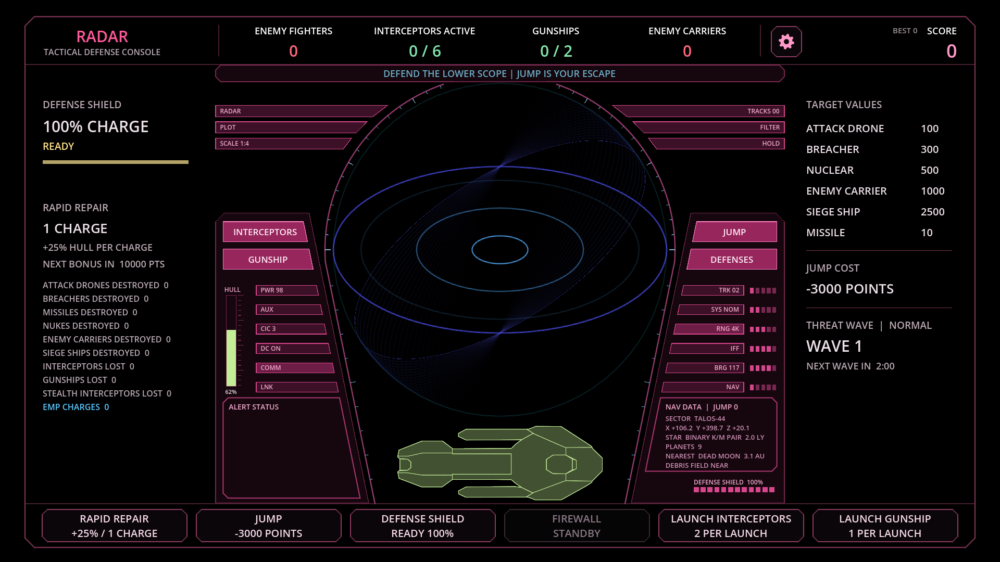
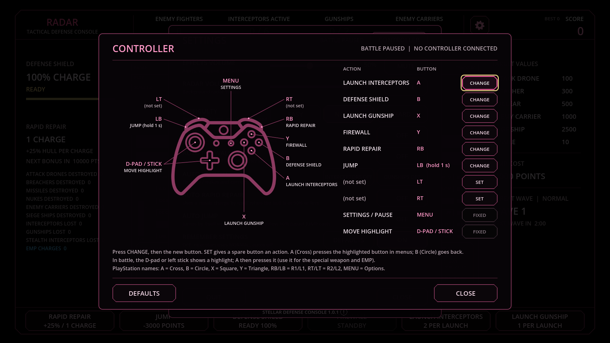

# Stellar Defense Console

A tactical space defense game for Windows (x64 and arm64), Mac (Apple M-series and Intel) and Linux. Enemy fighters, Breachers, Attack Drones, nuclear missiles, Enemy Carriers and Siege Ships close in on the radar scope in rising waves. Defend the SDF Aegis with Interceptors, Gunships, the Defense Shield, the Firewall and the EMP, using a mouse, a touch screen or a game controller.

## Features

- An animated 3D radar dome with a sweep pulse and original synthesized audio.
- Defined waves in sets, with rising threats, a score multiplier and bonuses.
- Protect the Fleet rounds, where Interceptors defend a Civilian Convoy.
- A console frame with an alert box, NAV DATA and a hull gauge with percentage.
- Interceptor squadrons, Gunships, a Stealth Interceptor special weapon, Rapid Repair and Jump.
- Easy, Normal and Hard difficulty, and optional automatic modes.
- High scores with per-battle stats; settings saved on the computer.
- Game controller support with remappable buttons.

## Supported computers

| Computer | Download |
|---|---|
| Windows PC with an Intel or AMD processor (x64) | `Stellar_Defense_Console_<version>_Windows_x64.exe` |
| Windows PC with an ARM processor (arm64), such as a Surface Pro or Snapdragon laptop | `Stellar_Defense_Console_<version>_Windows_arm64.exe` |
| Mac with an Apple M-series chip (M1 or later) or an Intel processor | `Stellar_Defense_Console_<version>_Mac.zip` (one Universal app for both) |
| Linux PC with an Intel or AMD processor (x86_64) | `Stellar_Defense_Console_<version>_Linux.tar.gz` |

## Download and play

Ready-to-play copies are on the [Releases](https://github.com/S8619G/Stellar-Defense-Console/releases) page.

- **Windows:** download the `.exe` for your PC and double-click it. The game is not code-signed, so Windows may show "Windows protected your PC". Click **More info**, then **Run anyway**.
- **Mac:** open the `.zip` and drag **Stellar Defense Console** to Applications. The app is not notarized. The first time, macOS may say it cannot check the app. Close that message, open **System Settings > Privacy & Security**, scroll down and click **Open Anyway** next to Stellar Defense Console.
- **Linux:** extract the `.tar.gz` and run `Stellar_Defense_Console_<version>_Linux.x86_64`.

No installation or extra software is needed.

**Photosensitivity warning:** the game contains flashing lights, full-screen flashes and pulsing images. See [NOTICE.md](NOTICE.md) before playing.

## Controls

Click or tap the console buttons along the bottom of the screen: RAPID REPAIR, JUMP, DEFENSE SHIELD, FIREWALL, LAUNCH INTERCEPTORS and LAUNCH GUNSHIP. The gear button opens Settings. Esc closes menus.

### Game controller

Xbox-style and PlayStation-style controllers are supported. Buttons can be changed in **Settings > CONTROLLER**.

| Button | In battle |
|---|---|
| A (Cross) | Launch Interceptors |
| B (Circle) | Defense Shield on/off |
| X (Square) | Launch Gunship |
| Y (Triangle) | Firewall on/off |
| RB (R1) | Rapid Repair |
| LB (L1) | Jump, held for one second |
| LT / RT (L2 / R2) | Not set; can be given any action |
| MENU (Options) | Opens or closes Settings (pauses the battle) |
| D-pad or left stick | Highlights the console buttons, the special weapon and the EMP; A presses the highlighted button |

In menus, the D-pad or left stick moves the highlight, A selects and B goes back.

## Running from source

1. Install [Godot 4.7](https://godotengine.org/download).
2. Download this repository (green **Code** button > **Download ZIP**) and extract it.
3. In Godot's Project Manager, click **Import**, choose the `project.godot` file and open it.
4. Press F5 to play.

Many balance values can be changed in the Godot Inspector on the **Contacts** node.

## License

Copyright (c) 2026 S8619G. All rights reserved. The source is published for viewing only; see [LICENSE](LICENSE). Built with the Godot Engine, which is licensed separately under the MIT License; see [NOTICE.md](NOTICE.md).
